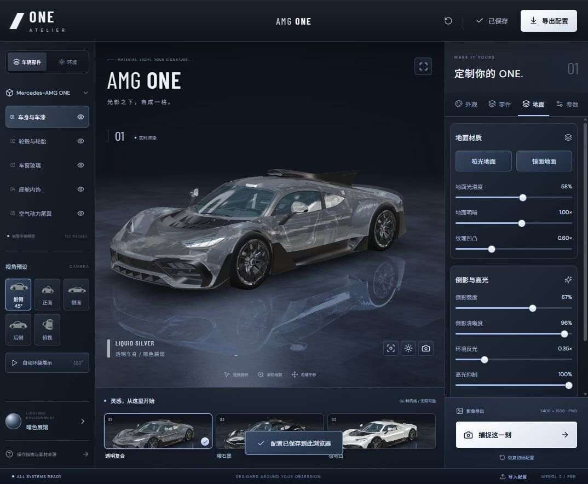

# ONE ATELIER · AMG ONE Configurator

一个运行在浏览器里的 3D 汽车配置器。用于展示实时材质、环境光照、模型交互和参数化外观，不含收费或支付功能。



## 功能

- 鼠标 / 触屏旋转、缩放和平移；五种预设视角、自动环绕、纯净视图。
- 车身颜色、透明车身、金属漆、高光漆、哑光漆和碳纤维外观。
- 透明度、粗糙度、清漆、玻璃深色度和轮毂饰面。
- 原模型部件显示、尾翼安装 / 移除、涂装、灯光，以及有限范围的姿态调整。
- 三套全景环境，环境方向、强度和曝光调节。
- 独立地面面板：光滑度、明暗、纹理凹凸、倒影强度 / 清晰度、环境反光与高光抑制；提供哑光 / 镜面预设。
- 浏览器本地保存、配置 JSON 导入导出、2400 × 1500 PNG 截图。

## 本地运行

需要 Node.js 22.18 或更新版本，以及 npm。

```bash
git clone https://github.com/ModerateRain/amg-one-configurator.git
cd amg-one-configurator
npm ci
npm run dev
```

打开 <http://127.0.0.1:5180/>。Windows 也可以双击 `启动配置工坊.cmd`。

```bash
npm run build       # 类型检查和生产构建，输出到 dist/
npm run preview     # 预览生产构建
npm run test:camera # 相机回归测试
```

运行时只需要静态文件服务，无需数据库、后端或 API 密钥。模型、环境与字体随仓库提供，浏览器需支持 WebGL 2。

## 技术与结构

| 技术 | 用途 |
| --- | --- |
| React 19 + TypeScript | 界面与交互 |
| Three.js + React Three Fiber | 3D 场景和实时渲染 |
| Drei | 相机控制、环境照明、阴影和地面反射 |
| Zustand | 配置状态及本地保存 |
| Vite | 开发服务和构建 |

```text
src/
  App.tsx          中文界面、参数面板、配置导入导出
  Scene.tsx        模型、材质、照明、地面、截图
  camera.ts        视角预设和最短旋转路径
  store.ts         配置、色卡、默认值和保存
  materials.ts     程序化混凝土纹理
public/
  models/          GLB 车模
  environments/    全景环境
  fonts/           自托管字体及许可证
  previews/        应用渲染的外观缩略图
  credits.html     素材署名
scripts/
  check-camera.mjs 相机回归测试
  inspect-model.mjs 模型结构检查
```

## 渲染说明

车模约 38.8 万三角面、152 个网格。加载时将网格变换归一化，按部件使用独立材质。透明车身采用透明混合近似；地面结合程序化混凝土颜色、粗糙度、法线纹理和实时平面反射。

预设视角会选择半圈以内的最短旋转路径，避免累计环绕后快速倒转。地面滑块直接更新材质和着色器参数，复用反射缓冲区。

姿态、部件与材质参数用于外观展示，不是车辆工程计算。当前轮毂选项更换饰面，不更换几何造型。

## 模型署名与许可证

**Transparency Mercedes AMG One**，作者 **[Dave Love SketchFab / Tyler_Dave](https://sketchfab.com/Tyler_Dave)**。

- [Sketchfab 模型原页面](https://sketchfab.com/3d-models/transparency-mercedes-amg-one-31e09c5fe7a04ef2b47f998485de9cf6)
- [CC BY 4.0](https://creativecommons.org/licenses/by/4.0/)
- 本项目修改了运行时材质、照明和部件变换，并修正了所提供 GLB 的错误署名元数据；网格、材质数据及图像二进制内容未修改。

项目原创代码以 [MIT](LICENSE) 开源，免费分享。第三方模型、环境图、字体和图标不因代码许可证而重新授权，完整来源见 [ASSETS.md](ASSETS.md)。

本项目为独立技术展示，与 Mercedes-Benz 官方无关联。仓库发布不涉及 Sites 托管。
