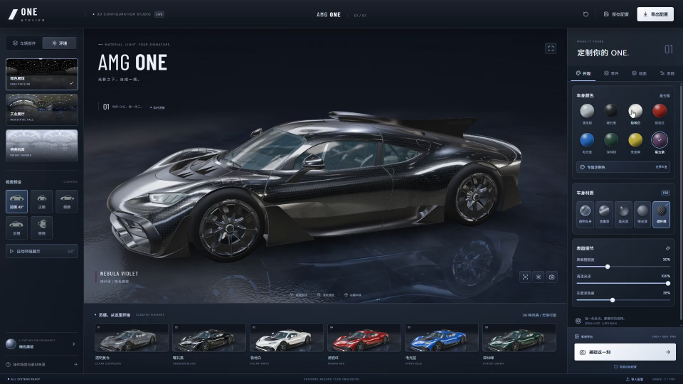
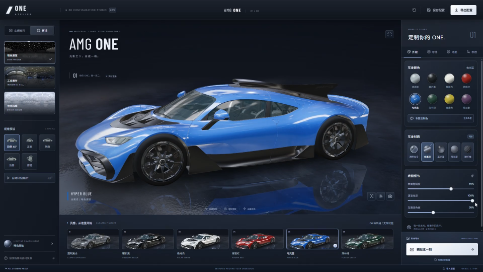

# ONE ATELIER · AMG ONE Configurator

ONE ATELIER 是一个基于 React 和 Three.js 的开源 3D 汽车配置器。你可以在浏览器里为 AMG ONE 更换车漆和材质、调整展厅灯光与地面倒影，从不同角度查看效果并导出截图。

## 演示视频

https://github.com/user-attachments/assets/fd2b9b63-2cd7-4234-8ce7-9a783394cdc3

点击播放，查看约一分钟的完整操作演示（含音频）。

## 界面截图

| 碳纤维外观 | 电光蓝车漆 |
| :---: | :---: |
|  |  |

## 功能

- **视角** · 用鼠标或触屏旋转、缩放和平移，支持五种预设视角、自动环绕和纯净视图。
- **车身** · 切换透明车身、金属漆、高光漆、哑光漆和碳纤维，调整车色、透明度、粗糙度、清漆光泽、车窗深浅和轮毂饰面。
- **部件** · 切换部件显示、竞速涂装和日间行车灯，调整车身高度与尾翼角度。
- **展厅** · 切换三套全景环境，调整光照方向、强度和曝光。地面支持哑光与镜面预设，可单独调节纹理、倒影和高光。
- **保存与导出** · 在当前浏览器保存配置，导入或导出 JSON，生成 2400 × 1500 PNG 截图。

## 本地运行

需要 Node.js 22.18 或更新版本，以及 npm。

```bash
git clone https://github.com/ModerateRain/amg-one-configurator.git
cd amg-one-configurator
npm ci
npm run dev
```

打开 <http://127.0.0.1:5180/>。Windows 也可以双击 `启动配置工坊.cmd`。

```bash
npm run build       # 类型检查和生产构建，输出到 dist/
npm run preview     # 预览生产构建
npm run test:camera # 相机回归测试
```

运行时只需要静态文件服务，无需数据库、后端或 API 密钥。模型、环境与字体随仓库提供，浏览器需支持 WebGL 2。

## 技术与结构

| 技术 | 用途 |
| --- | --- |
| React 19 + TypeScript | 界面与交互 |
| Three.js + React Three Fiber | 3D 场景和实时渲染 |
| Drei | 相机控制、环境照明、阴影和地面反射 |
| Zustand | 配置状态及本地保存 |
| Vite | 开发服务和构建 |

```text
src/
  App.tsx          中文界面、参数面板、配置导入导出
  Scene.tsx        模型、材质、照明、地面、截图
  camera.ts        视角预设和最短旋转路径
  store.ts         配置、色卡、默认值和保存
  materials.ts     程序化混凝土纹理
public/
  models/          GLB 车模
  environments/    全景环境
  fonts/           自托管字体及许可证
  previews/        应用渲染的外观缩略图
  credits.html     素材署名
scripts/
  check-camera.mjs 相机回归测试
  inspect-model.mjs 模型结构检查
```

## 渲染说明

车模由约 38.8 万个三角面和 152 个网格组成。车身按部件配置材质，透明车身采用透明混合。地面使用程序化混凝土纹理和实时平面反射，车身、光照和倒影会随配置实时更新。

## 模型署名与许可证

**Transparency Mercedes AMG One**，作者 **[Dave Love SketchFab / Tyler_Dave](https://sketchfab.com/Tyler_Dave)**。

- [Sketchfab 模型原页面](https://sketchfab.com/3d-models/transparency-mercedes-amg-one-31e09c5fe7a04ef2b47f998485de9cf6)
- [CC BY 4.0](https://creativecommons.org/licenses/by/4.0/)
- 本项目更新了 GLB 的署名信息，并在运行时调整材质、照明和部件变换。

项目原创代码以 [MIT](LICENSE) 开源，免费分享。第三方模型、环境图、字体和图标不因代码许可证而重新授权，完整来源见 [ASSETS.md](ASSETS.md)。

本项目为独立的 3D 交互演示，与 Mercedes-Benz 官方无关联。
